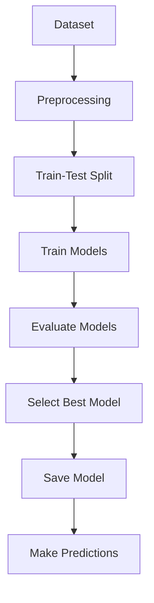

# Predictive Modeling Using Machine Learning

A beginner-friendly Python project that predicts student Pass or Fail outcomes using supervised machine learning.

## Objective
Train and compare Logistic Regression, Decision Tree, and Random Forest classifiers.

## Dataset
The project creates a synthetic dataset with 1,500 rows. It is not real student data.

- Study_Hours
- Attendance
- Previous_Marks
- Assignment_Score
- Final_Marks
- Result

Pass is defined as Final_Marks >= 50; otherwise, the result is Fail.

Student_ID is not used as a model feature. Final_Marks is excluded because it is used to create the target label.

## Workflow



## Installation

```bash
pip install -r requirements.txt
```

## Run the project

First train and evaluate the models:

```bash
python main.py
```

Then predict a result:

```bash
python predict.py
```

## Evaluation metrics
- Accuracy: overall correctness.
- Precision: correctness among predicted Pass cases.
- Recall: actual Pass cases correctly identified.
- F1-score: balance between precision and recall.
- ROC-AUC: ability to rank Pass above Fail.

## Generated outputs
- model_comparison.csv
- evaluation_report.txt
- models/best_model.joblib
- visualizations/model_accuracy.png
- visualizations/model_metrics.png
- visualizations/confusion_matrix.png
- visualizations/roc_curve.png
- visualizations/feature_importance.png
- visualizations/class_distribution.png
- visualizations/model_dashboard.png

## Limitations
This is a synthetic educational demonstration. Do not use it for real academic decisions. Model probabilities are not guarantees.

## Future enhancements
- Add a web interface.
- Add cross-validation.
- Add automated tests.

## Author
Muthu Anandh S
